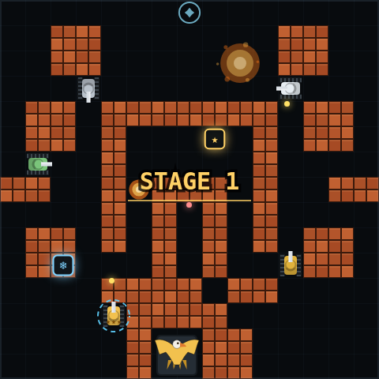

# 坦克大战 · Tank Battle

一个使用 **Next.js + React + Canvas** 从零实现的经典 Battle City（坦克大战）风格网页游戏。所有画面都由 Canvas 实时绘制，没有使用任何图片素材。



## 功能

- 3 个精心设计的地图关卡：外围阵地、水泽要塞、钢铁核心
- 砖墙可摧毁、钢墙需要三星火力、水面阻挡坦克、草丛隐藏坦克
- 4 种敌军坦克：普通、快速、强力、装甲（装甲需要 3 发子弹）
- 闪烁红光的敌军会掉落道具
- 5 种道具：火力升级 ★、额外生命 ♥、全屏炸弹 ✹、冻结敌军 ❄、护盾 ◈
- 基地老鹰保护机制：基地被摧毁即游戏结束
- 分数、最高分（localStorage 持久化）、生命、关卡、剩余敌军 HUD
- 暂停 / 继续、音效开关、Web Audio 合成音效（无需音频文件）
- 键盘 + 触屏虚拟摇杆操作，适配桌面与移动端
- 固定时间步长游戏循环，画面使用 requestAnimationFrame
- 完整 TypeScript 类型

## 快速开始

```bash
npm install
npm run dev
```

打开 http://localhost:3000 即可游玩。

生产构建：

```bash
npm run build
npm run start
```

## 操作方式

| 操作 | 按键 |
| --- | --- |
| 移动 | `↑` `↓` `←` `→` 或 `W` `A` `S` `D` |
| 射击 | `空格` 或 `J`（按住可连射） |
| 暂停 / 继续 | `P` 或 `Esc` |
| 开始 / 重新开始 | `Enter` |
| 音效开关 | `M` |

移动端会自动显示左下方向键与右下 FIRE 按钮。

## 玩法提示

- 保护地图底部的老鹰基地，基地周围的砖墙被打穿后敌军子弹可以直接摧毁基地。
- 消灭全部敌军即可进入下一关，三关全部通过后获得胜利。
- 吃下 ★ 可以升级火力：二级解锁双发子弹，三级子弹可以击穿钢墙。
- 敌军闪红并快速切换颜色时，击毁它会掉落一个道具。
- 基地失守或生命耗尽都会立即结束游戏，但最高分会保留。

## 道具

| 图标 | 名称 | 效果 |
| --- | --- | --- |
| ★ | 火力升级 | 提升主炮等级（最高 3 级） |
| ♥ | 额外生命 | 生命 +1（上限 5） |
| ✹ | 全屏炸弹 | 立即消灭场上所有敌军 |
| ❄ | 冻结 | 敌军停止行动 7 秒 |
| ◈ | 护盾 | 玩家无敌 10 秒 |

## 项目结构

```
app/
  layout.tsx          # 根布局与元数据
  page.tsx            # 游戏页面
  globals.css         # 整体视觉与触屏控件样式
  icon.svg            # 站点图标
components/
  TankBattle.tsx      # React 外壳：HUD、开始/暂停/结算浮层、触屏输入
game/
  constants.ts        # 地图尺寸、方向、碰撞常量
  levels.ts           # 3 个关卡的字符地图
  engine.ts           # 游戏引擎：循环、AI、碰撞、道具、渲染
  sfx.ts              # Web Audio 合成音效
```

## 实现要点

- **固定时间步长**：物理与 AI 以 1/60 秒更新，渲染跟随 `requestAnimationFrame`，不同刷新率下手感一致。
- **纯 Canvas 渲染**：砖块、钢墙、水面、草丛、坦克、爆炸、基地老鹰全部由代码绘制。
- **网格车道辅助**：转向时自动对齐到最近的 16px 车道，避免 28px 坦克卡在 32px 走廊拐角。
- **无外部资源**：字体使用系统等宽字体，音效由 Web Audio Oscillator 实时合成。
- **SSR 安全**：游戏引擎只在客户端 `useEffect` 中初始化，并处理了 React StrictMode 的重复挂载。

## 技术栈

- Next.js 16（App Router）
- React 19
- TypeScript 5
- HTML5 Canvas 2D
- Web Audio API
- CSS（无 UI 框架）
